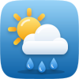
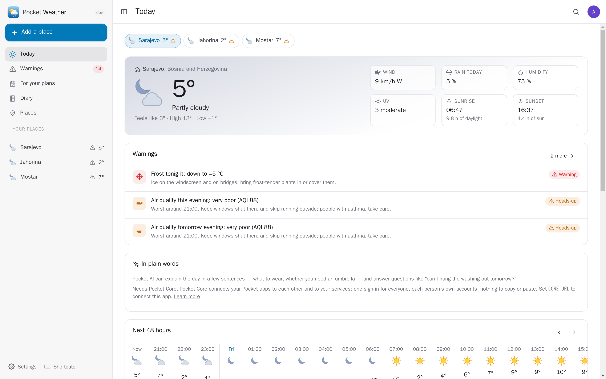
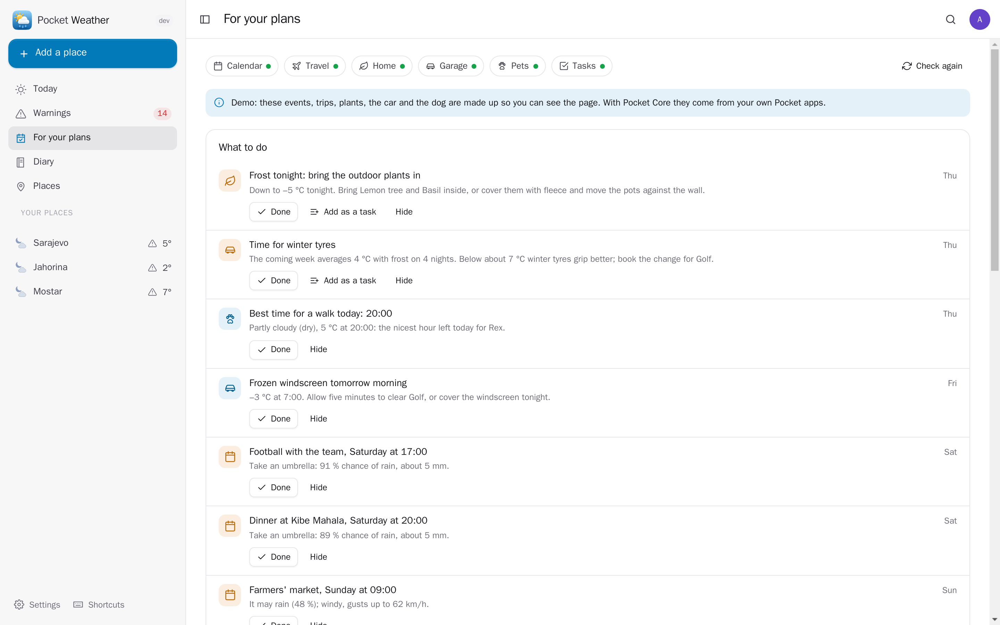
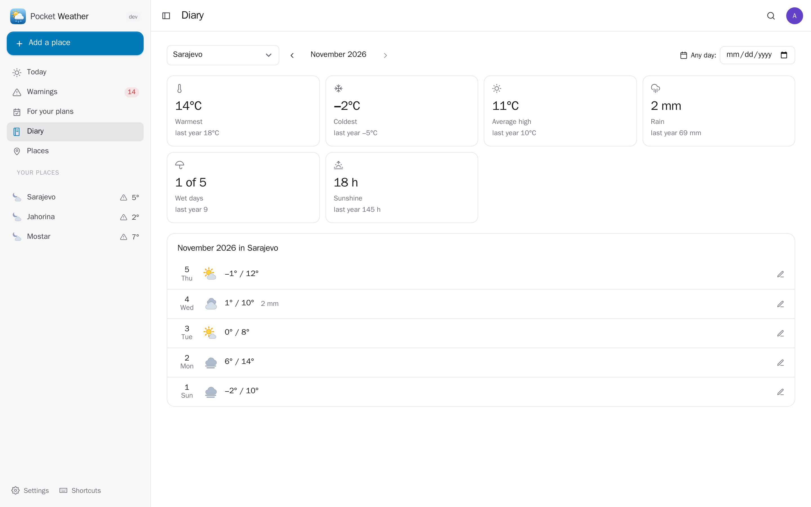
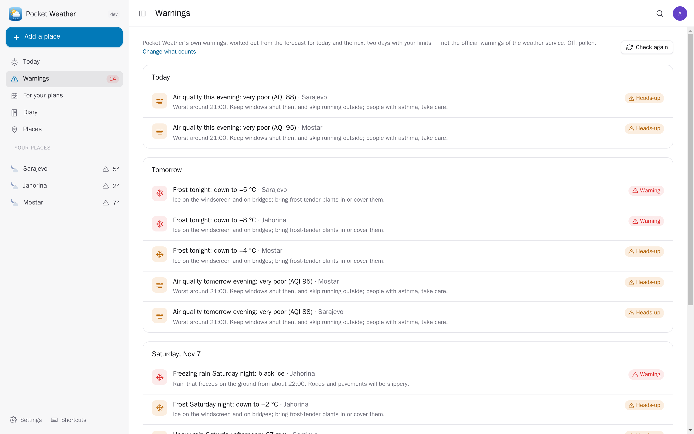
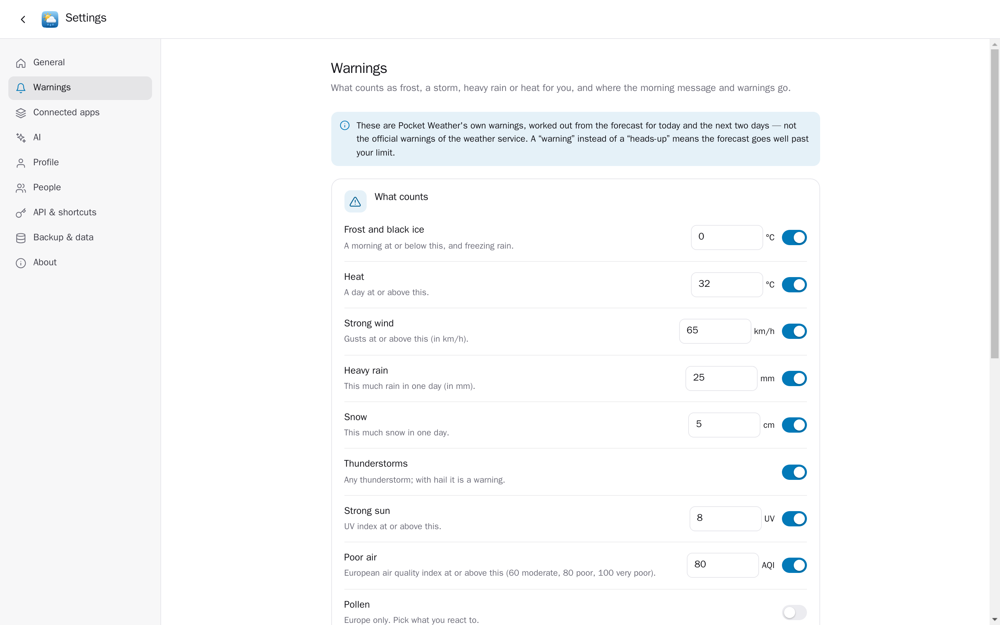
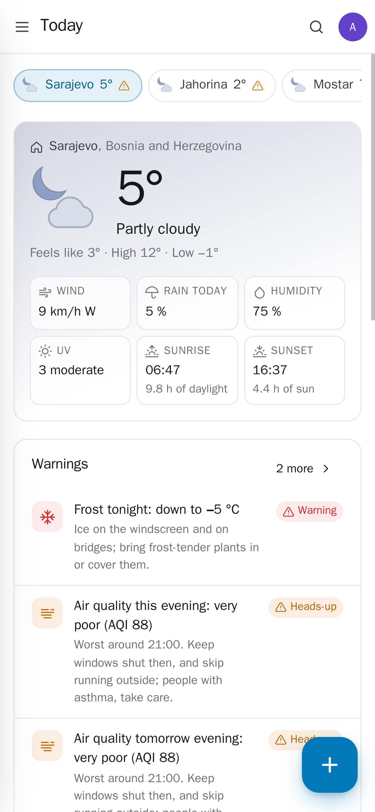
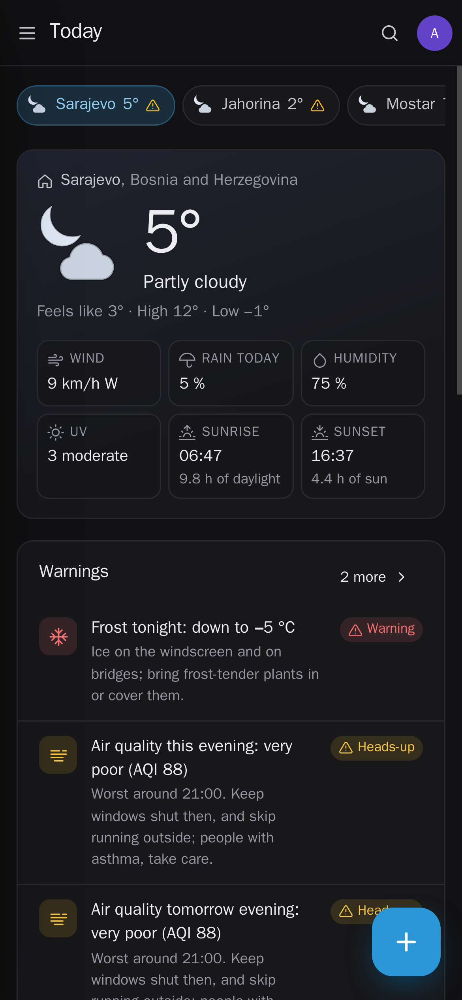

<p align="center"></p>
<h1 align="center">Pocket Weather</h1>
<p align="center">The weather for your places and wherever you are: now, 48 hours and ten days, air quality and pollen, and warnings for frost, storms, heavy rain, heat and strong sun with the limits you choose. It puts the weather on your events and trips, says when to bring the balcony plants in, change the tyres or walk the dog, keeps a diary of every day, and explains the day in plain words with Pocket AI.<br>One Go binary, one SQLite file, one volume. Part of the Pocket apps; works on its own too.</p>
<p align="center">
  <a href="https://github.com/abjelosevic88/pocket-homelab-weather/actions"></a>
  <a href="https://github.com/abjelosevic88/pocket-homelab-weather/pkgs/container/pocket-homelab-weather"></a>
  <a href="LICENSE"></a>
</p>

---

<p align="center"></p>

<table>
  <tr>
    <td width="50%"></td>
    <td width="50%"></td>
  </tr>
  <tr>
    <td align="center"><sub>For your plans: frost for the balcony plants, winter tyres, the best hour to walk the dog, rain at Saturday's match.</sub></td>
    <td align="center"><sub>The diary: every day at your places, the month in numbers next to last year's, your own notes.</sub></td>
  </tr>
  <tr>
    <td width="50%"></td>
    <td width="50%"></td>
  </tr>
  <tr>
    <td align="center"><sub>Warnings by day at all your places: a heads-up, or a warning when the forecast goes well past your limit.</sub></td>
    <td align="center"><sub>You decide what counts: frost at 0 °C or −3 °C, gusts, rain, heat, UV, air, the pollen you react to.</sub></td>
  </tr>
  <tr>
    <td width="50%"></td>
    <td width="50%"></td>
  </tr>
  <tr>
    <td align="center"><sub>Made for the phone: your places as chips, the day at a glance.</sub></td>
    <td align="center"><sub>Light and dark follow the system.</sub></td>
  </tr>
</table>

## What it does

- **Your places**: home, the cottage, your parents' town — found by name or "use where I am now". Each has its own forecast, warnings and diary; home is the one the morning message, Pocket Day and Pocket AI use.
- **Now, 48 hours, ten days**: temperature and feels-like, rain chance and amount, wind and gusts, humidity, UV, sunrise and sunset; tap a day for the rest.
- **Air and pollen**: the European air quality index now and per day, and alder, birch, grass, olive, mugwort and ragweed pollen (Europe).
- **Warnings with your limits**: frost and black ice, heat, strong wind, heavy rain, snow, thunderstorms, strong sun, poor air and pollen, for today and the next two days. A new or worse one is pushed (Apprise, ntfy or a webhook) with quiet hours at night; the morning message brings the day ahead.
- **The diary**: every day at your places is kept — high and low, rain, snow, wind, sun, air — with your own notes, the month in numbers next to last year's, and any past date looked up.
- **Everyone their own**: each person has their own places, warnings, diary, settings and connections; admins see no one else's.
- **Export** as JSON (and back in) or the diary as CSV; a whole-database backup for admins.

These are Pocket Weather's own warnings worked out from the forecast, not the official ones of the weather service.

## Run it

```sh
docker run -d --name pocket-weather -p 8080:8080 -v ./data:/data \
  -e BASE_URL=https://weather.example.com -e SECURE_COOKIES=true \
  ghcr.io/abjelosevic88/pocket-homelab-weather:latest
```

or `docker compose up -d` with [docker-compose.yml](docker-compose.yml). Open it, create the first account and add your town. "Use where I am now" needs HTTPS (or localhost). All options: [docs/configuration.md](docs/configuration.md). API: [docs/api.md](docs/api.md).

## With Pocket Core

Set `CORE_URL` and `CORE_REGISTRATION_KEY` and Weather joins the box: people sign in with Pocket Core, and through app links each person's Weather reaches their own Pocket apps with nothing to paste:

| App | What Weather does there | Scopes |
|---|---|---|
| Pocket Calendar | the weather at your events of the next three days, at their place when it can be found; "take an umbrella" when it will rain then | `calendar:read` |
| Pocket Travel | the forecast at your trips' destinations, what to pack, and last year's weather there while a trip is too far ahead | `trips:read` |
| Pocket Home | balcony and garden plants: bring them in before frost, water them in the heat, secure the pots before a storm | `home:read` |
| Pocket Garage | time for winter or summer tyres (unless a tyre change is in your records), a frozen windscreen tomorrow | `vehicles:read` |
| Pocket Pets | the best hour to walk the dog, early and late walks in heat, short ones in the cold, thunder coming | `pets:read` |
| Pocket Movement | the weather where you are when you are away from your places (only the latest position) | `movement:read` |
| Pocket Tasks | "Add as a task" on a piece of advice | `tasks:write` |
| Pocket AI | the day in plain words — what to wear, whether to take an umbrella — and questions about the forecast; the Ask button on every page | inference |

Other apps can read your weather (`weather:read`: each day's weather and your diary notes in Pocket Day's journal, the Weather card in Pocket AI's briefing, `pocket_weather_*` tools in Pocket Core) or add a place to follow (`weather:write`). They never see your plans: event titles, plants, vehicles and pets stay in Weather. Events on the bus: `weather.warning`, `weather.today`. Without Core every connection can be made directly with a URL and a token; the Core-only choices stay visible, greyed out.

## Develop

```sh
make dev     # API on :8080 with demo data (made-up weather, no network) + Vite on :5173
make test    # go vet, go test, tsc
make         # web + binary
```

MIT licensed. Weather data by [Open-Meteo.com](https://open-meteo.com) (CC BY 4.0); place names © [OpenStreetMap](https://www.openstreetmap.org/copyright) contributors.
